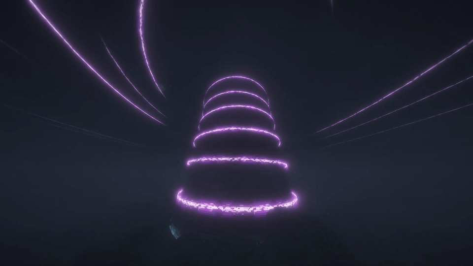
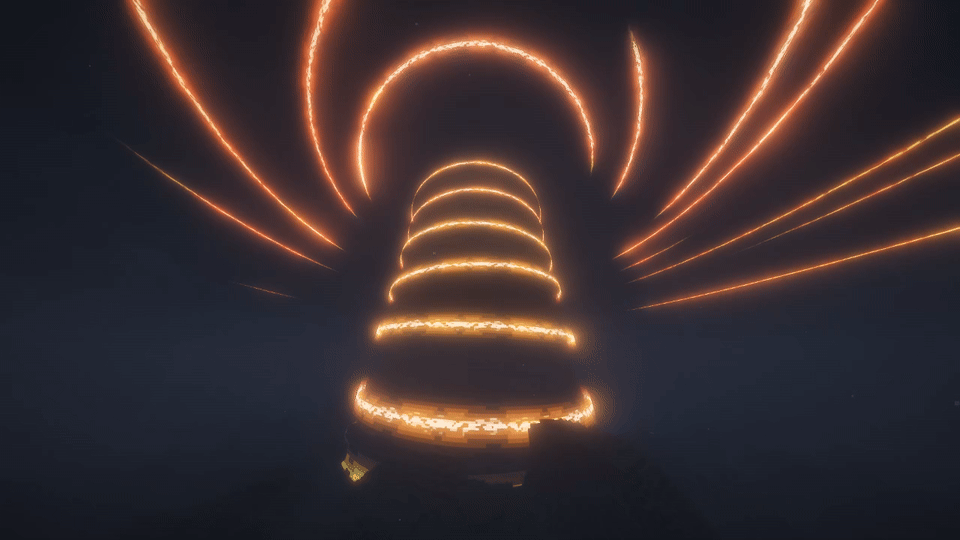
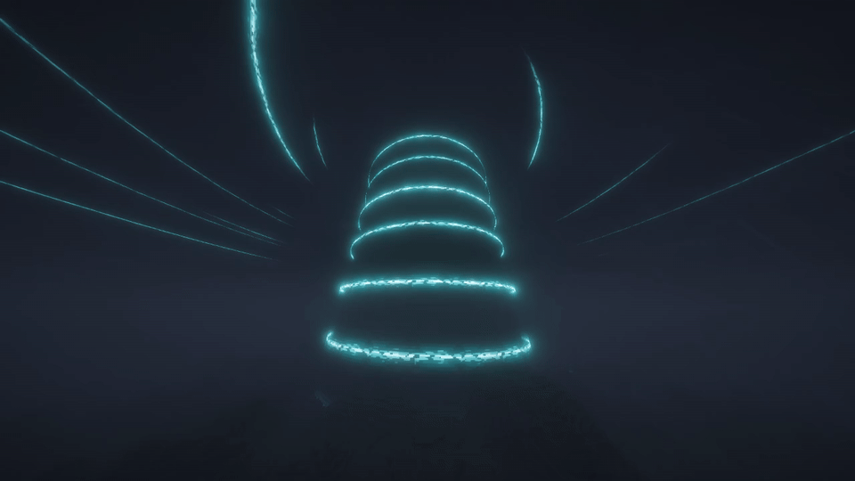
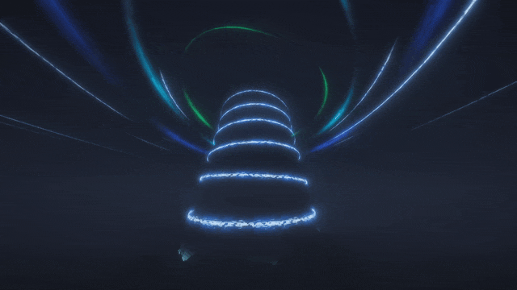
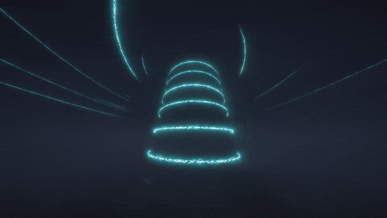

# GIF для CurseForge

Готовые вставки для Markdown. Для визуального редактора берите только URL между скобками и вставляйте его в поле URL/Source у изображения.

## Качество: 960×540, 20 кадров/с

```md







```

## Компактные: меньше 2 MB каждый, 640×360, 15 кадров/с

```md






```

Не увеличивайте компактные GIF сверх 640 px. Для HTML-режима готовы качественные вставки в CURSEFORGE.html.
