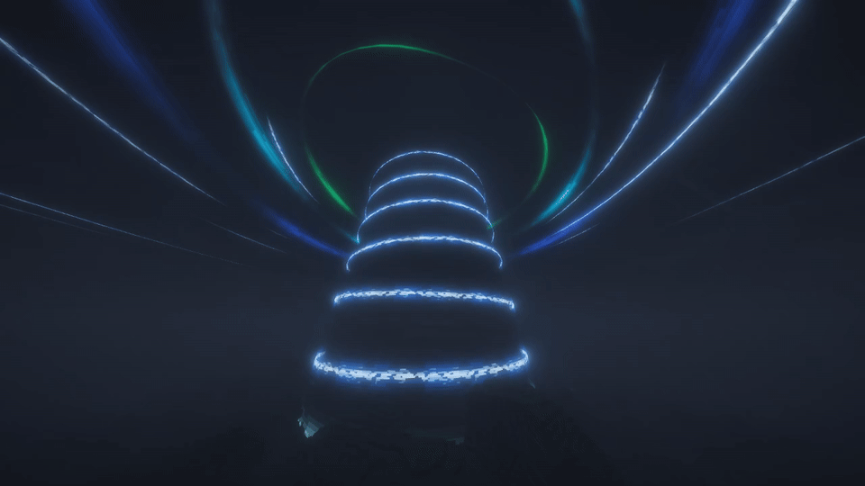
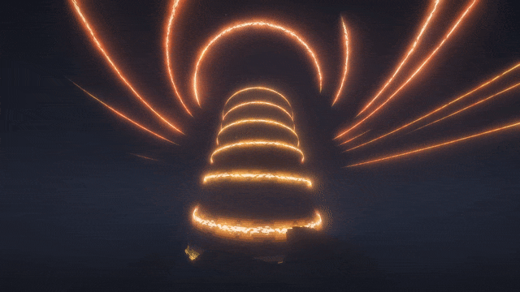

# GIF для CurseForge

Готовые вставки для Markdown. Для визуального редактора берите только URL между скобками и вставляйте его в поле URL/Source у изображения.

## Полная сцена рождения Void Rift — GIF

Та же смонтированная сцена, 21,8 секунды, бесконечный повтор, исходная скорость.

| Вариант | Размер кадра | Частота кадров | Вес | Прямая ссылка |
|---|---|---|---|---|
| Качество | 960×480 | 20 кадров/с | 28.42 MB | [GIF](https://dcvke.github.io/horizons-unbound-media/gif/void-rift-birth.gif) |
| Полегче | 720×360 | 15 кадров/с | 12.28 MB | [GIF](https://dcvke.github.io/horizons-unbound-media/gif/void-rift-birth-light.gif) |

Для качественного варианта вставьте в Markdown:

```md

```

Для облегчённого варианта:

```md

```

В визуальном редакторе CurseForge откройте вставку изображения и поместите прямую ссылку GIF в поле URL/Source. Ширину качественного варианта можно установить до 960 px; облегчённого — до 720 px. Файлы размещены на GitHub, поэтому это вставка внешнего изображения. При загрузке файла с компьютера ограничения загрузчика CurseForge могут отличаться.

Для этой сцены используются ссылки GitHub Pages (`dcvke.github.io`) из того же медиарепозитория. Обе ссылки проверены без авторизации: HTTP 200, тип `image/gif`; все кадры опубликованных файлов успешно декодированы, длительность — ровно 21,8 секунды, повтор бесконечный.

Для каждого кадра GIF подобрана своя палитра до 256 цветов, с dithering Sierra для градиентов. Это сохраняет фиолетовое свечение даже при затемнении сцены. Финальный кадр и задержки проверены: длительность сохранена, анимация повторяется бесконечно. Часть одинаковых кадров оптимизатор может объединять, сохраняя их суммарную задержку.

## Качество: 960×540, 20 кадров/с

```md





```

## Компактные: меньше 2 MB каждый, 640×360, 15 кадров/с

```md





```

Не увеличивайте компактные GIF сверх 640 px. Для HTML-режима готовы качественные вставки в CURSEFORGE.html.
