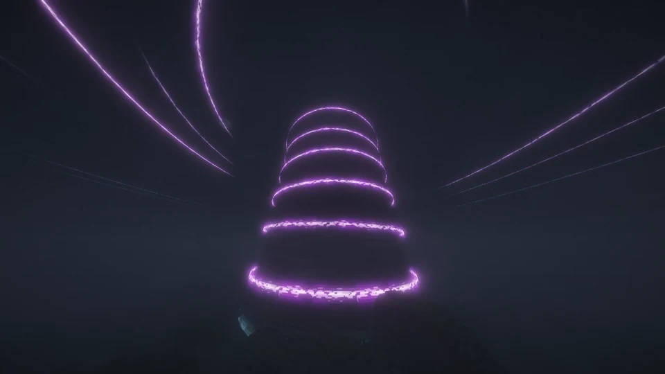
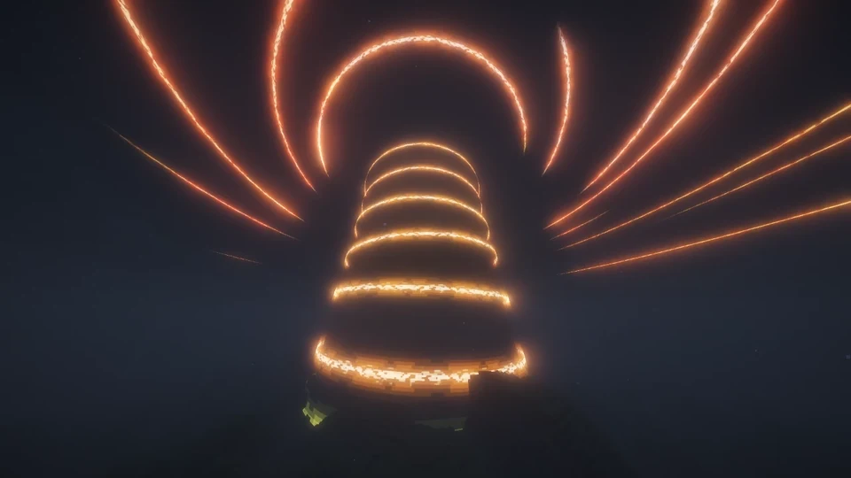
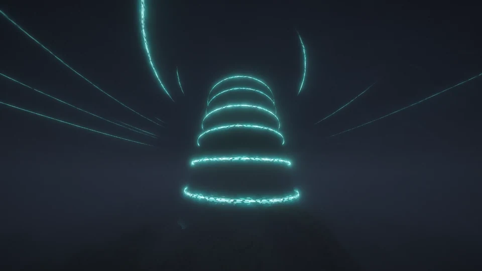

# Horizons Unbound — Media

Игровые ролики Horizons Unbound, записанные 15 ноября 2026 года: четыре коротких показа штормов и смонтированная сцена рождения Void Rift. Отдельный публичный репозиторий для вставки медиа в описания Modrinth и CurseForge.

## Сцена рождения Void Rift

[Прямая ссылка на MP4](https://raw.githubusercontent.com/dcvke/horizons-unbound-media/main/video/void-rift-birth.mp4) · [Файл на GitHub](video/void-rift-birth.mp4) · [Параметры монтажа и проверки](edits/void-rift-birth.json)

21,8 секунды, 1280×640, 30 кадров/с, H.264, 7,80 MB, без аудиодорожки. Вырезаны первые 10,2 секунды затянутого вступления и возврат в игру после финального затемнения. Чёрные полосы по 40 px сверху и снизу удалены вместе с подсказкой Shift. Игровые субтитры и титр The Void Rift сохранены; добавлен короткий плавный вход и 0,6 секунды на чтение финальной реплики. Скорость сцены исходная, масштабирование не применялось.

Это отдельный смонтированный ролик; четыре коротких показа ниже доступны по своим прежним ссылкам. Готовая вставка для Modrinth находится в начале [MODRINTH.md](MODRINTH.md).

Видео целиком декодируется без ошибок и не содержит аудиопотоков. Прямые ссылки на MP4 и постер проверены без авторизации: HTTP 200, контрольные суммы совпадают с экспортом. Короткое затемнение при смене ракурса внутри сцены взято из исходной катсцены.


GIF этой сцены для CurseForge: [960×480, 20 кадров/с, 28.42 MB](https://dcvke.github.io/horizons-unbound-media/gif/void-rift-birth.gif) или [720×360, 15 кадров/с, 12.28 MB](https://dcvke.github.io/horizons-unbound-media/gif/void-rift-birth-light.gif). Оба варианта содержат полные 21,8 секунды с бесконечным повтором. [Готовые вставки](CURSEFORGE.md).

Большие GIF этой сцены раздаются через GitHub Pages того же репозитория: проверен правильный тип `image/gif`, совпадение контрольных сумм и декодирование всех кадров по публичным ссылкам. Изображения в репозитории не перекодируются при раздаче.

## Файлы

| Шторм | Исходная длительность | MP4 без звука | WebP 1280×720, 30 fps | WebP 960×540, 20 fps | GIF 960×540, 20 fps | GIF 640×360, 15 fps |
|---|---|---|---|---|---|---|
| Overworld — Thunder Funnel | 3.135 с | [MP4](https://raw.githubusercontent.com/dcvke/horizons-unbound-media/main/video/overworld-storm.mp4) | [WebP](https://raw.githubusercontent.com/dcvke/horizons-unbound-media/main/webp/overworld-storm.webp), 3.07 MB | [WebP](https://raw.githubusercontent.com/dcvke/horizons-unbound-media/main/webp-compact/overworld-storm.webp), 1.11 MB | [GIF](https://raw.githubusercontent.com/dcvke/horizons-unbound-media/main/gif/overworld-storm.gif), 10.38 MB | [GIF](https://raw.githubusercontent.com/dcvke/horizons-unbound-media/main/gif-compact/overworld-storm.gif), 1.33 MB |
| End — Void Rift | 3.236 с | [MP4](https://raw.githubusercontent.com/dcvke/horizons-unbound-media/main/video/end-storm.mp4) | [WebP](https://raw.githubusercontent.com/dcvke/horizons-unbound-media/main/webp/end-storm.webp), 2.79 MB | [WebP](https://raw.githubusercontent.com/dcvke/horizons-unbound-media/main/webp-compact/end-storm.webp), 1.01 MB | [GIF](https://raw.githubusercontent.com/dcvke/horizons-unbound-media/main/gif/end-storm.gif), 9.30 MB | [GIF](https://raw.githubusercontent.com/dcvke/horizons-unbound-media/main/gif-compact/end-storm.gif), 1.25 MB |
| Nether — Fire Twister | 3.066 с | [MP4](https://raw.githubusercontent.com/dcvke/horizons-unbound-media/main/video/nether-storm.mp4) | [WebP](https://raw.githubusercontent.com/dcvke/horizons-unbound-media/main/webp/nether-storm.webp), 3.95 MB | [WebP](https://raw.githubusercontent.com/dcvke/horizons-unbound-media/main/webp-compact/nether-storm.webp), 1.43 MB | [GIF](https://raw.githubusercontent.com/dcvke/horizons-unbound-media/main/gif/nether-storm.gif), 9.16 MB | [GIF](https://raw.githubusercontent.com/dcvke/horizons-unbound-media/main/gif-compact/nether-storm.gif), 1.53 MB |
| Deep Dark — Deep Whisper | 3.167 с | [MP4](https://raw.githubusercontent.com/dcvke/horizons-unbound-media/main/video/deep-dark-storm.mp4) | [WebP](https://raw.githubusercontent.com/dcvke/horizons-unbound-media/main/webp/deep-dark-storm.webp), 2.47 MB | [WebP](https://raw.githubusercontent.com/dcvke/horizons-unbound-media/main/webp-compact/deep-dark-storm.webp), 0.88 MB | [GIF](https://raw.githubusercontent.com/dcvke/horizons-unbound-media/main/gif/deep-dark-storm.gif), 5.54 MB | [GIF](https://raw.githubusercontent.com/dcvke/horizons-unbound-media/main/gif-compact/deep-dark-storm.gif), 1.15 MB |

- `video/`: MP4 без аудиодорожек. Исходный видеопоток H.264 скопирован без перекодирования; качество, разрешение, число кадров и их временные метки сохранены. Ссылки на файлы остались прежними. Контейнеры пересобраны для удаления звука и быстрого начала воспроизведения.
- `webp/`: анимированный WebP в исходном разрешении и с исходной частотой кадров, quality 92. Полный цвет, без звука, бесконечный повтор. Сжатие с потерями; исходное качество видеопотока сохраняется в MP4.
- `webp-compact/`: WebP для описания страницы: 960×540, 20 кадров/с, quality 88.
- `gif/`: четыре коротких показа штормов с адаптивной палитрой 256 цветов, dithering Sierra и оптимизацией Gifsicle без дополнительного lossy-сжатия. Для полной сцены `void-rift-birth` используются отдельная палитра каждого кадра и оптимизация Gifsicle lossy 20 (960 px) или 30 (720 px).
- `gif-compact/`: GIF по 1,15–1,53 MB, 640×360, 15 кадров/с, Gifsicle lossy 30. Резерв для загрузчиков с небольшим лимитом.
- `posters/`: статичные кадры из середины роликов.

Все анимации содержат полный ролик и идут с исходной скоростью. Небольшое округление длительности связано с частотой кадров и шагом задержек формата GIF. Никаких чёрных полей, растягивания, водяных знаков или искусственного увеличения до 4K.

## Вставка в Modrinth

Готовые блоки для всех четырёх MP4: [MODRINTH.md](MODRINTH.md). Скопируйте HTML из блока кода в редактор описания. Для автоматического повторения можно добавить `autoplay`; браузер может ограничивать автозапуск.

```html
<video controls loop muted width="1280">
  <source src="https://raw.githubusercontent.com/dcvke/horizons-unbound-media/main/video/end-storm.mp4" type="video/mp4">
</video>
```

Более лёгкая анимация без кнопок плеера:

```md

```

Используйте прямой URL файла. Адрес `github.com/.../blob/...` ведёт на страницу просмотра, а не на сами байты видео или картинки. GitHub хранит исходное разрешение; эти записи сделаны в 720p, не в 4K.

GitHub Raw отдаёт MP4 как `application/octet-stream`; в блоках указан явный `type="video/mp4"`. Синтаксис проверен по исходному коду Modrinth, однако вставка в его живом редакторе не тестировалась.

## Вставка в CurseForge

Готовые блоки всех четырёх GIF: [CURSEFORGE.md](CURSEFORGE.md), HTML: [CURSEFORGE.html](CURSEFORGE.html).

В визуальном редакторе используйте Insert Image → URL/Source и вставьте прямую ссылку на GIF из таблицы. В режиме Markdown вставьте ``; в режиме HTML — ``.

Сначала попробуйте GIF из `gif/`, размещённый на GitHub: он крупнее, но сохраняет больше деталей и кадров. Если загрузчик требует небольшой файл, используйте `gif-compact/` без увеличения ширины до 960 px. Лимит 2 MB здесь — выбранный запас совместимости, а не подтверждённый универсальный лимит CurseForge для внешних URL.

WebP передаёт свечение и градиенты лучше GIF и весит значительно меньше. При необходимости его можно попробовать через прямой `img src`, однако принятие анимированного WebP загрузчиком и конкретным редактором CurseForge отдельно не проверено. GIF оставлен как основной совместимый вариант. Прямой тег `<video>` не указан в актуальном списке поддерживаемых HTML-тегов CurseForge.

## Проверка исходников и анимаций

Все четыре исходника успешно декодированы целиком. Размер: 1280×720, около 30 кадров/с. Чёрных вставок и зависаний длительностью 0,3 с или больше автоматическая проверка не обнаружила. Просмотрены начало, середина и конец каждой записи: кадр без HUD, цвет шторма соответствует названию файла.

Длительности: 3,135 / 3,236 / 3,066 / 3,167 секунды. Это разные записи, а не четыре синхронные камеры. Для синхронного общего показа они не выровнены и не обрезаны. У всех четырёх опубликованных MP4 аудиодорожки удалены. Проверены совпадение сжатых видеопакетов с исходниками, временные метки каждого кадра и отсутствие аудиопотоков. При пересборке контейнера End округление длительности последнего кадра составило 11 микросекунд; остальные длительности совпали точно.

Проверены декодирование всех анимационных кадров, бесконечный повтор, наличие разных кадров и сохранение длительности с отклонением меньше 50 мс. Контрольные суммы: [SHA256SUMS.txt](SHA256SUMS.txt). Метаданные: [manifest.json](manifest.json).

Все 24 первоначально опубликованных медиафайла отвечают HTTP 200 без авторизации. Через публичные URL полностью скачаны четыре MP4 без звука, четыре компактных GIF и четыре компактных WebP; все 12 контрольных сумм совпали. GIF, WebP и JPEG выдаются с правильными MIME-типами. Результат: [public-verification.json](public-verification.json). В `manifest.json` раздел `source` описывает исходную запись, а раздел `video` — опубликованный MP4 без звука. Параметры новой смонтированной сцены описаны отдельно в `edits/void-rift-birth.json`.

Начало и конец исходников не являются специально снятой бесшовной петлёй: небольшой переход при повторе возможен. Искусственная интерполяция и обратное воспроизведение не применялись.

## Источники по форматам

Проверено 15 ноября 2026 года:

- [Modrinth: Advanced Markdown formatting](https://support.modrinth.com/en/articles/8801962-advanced-markdown-formatting) — HTML и Markdown в описаниях.
- [Официальный рендерер Modrinth](https://github.com/modrinth/code/blob/main/packages/utils/parse.ts) — поддержка медиа и разрешённые домены GitHub/raw.githubusercontent.com.
- [CurseForge: Supported HTML Tags & CSS for Project Descriptions](https://support.curseforge.com/support/solutions/articles/9000284625-supported-html-tags-css-for-project-descriptions) — разрешён `img` с `src`, `alt`, `width`, `height`; `video` в списке отсутствует.
- [CurseForge: Project Submission Guide and Tips](https://support.curseforge.com/support/solutions/articles/9000199552) — описание поддерживает изображения и видеовставки. Это не обещание поддержки произвольного MP4 через `<video>`.
- [Google: WebP FAQ](https://developers.google.com/speed/webp/faq) — полный цвет WebP и ограничения палитры GIF.

## Предпросмотр

### End — Void Rift


### Nether — Fire Twister



### Overworld — Thunder Funnel


### Deep Dark — Deep Whisper



