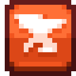
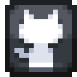
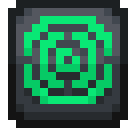
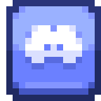
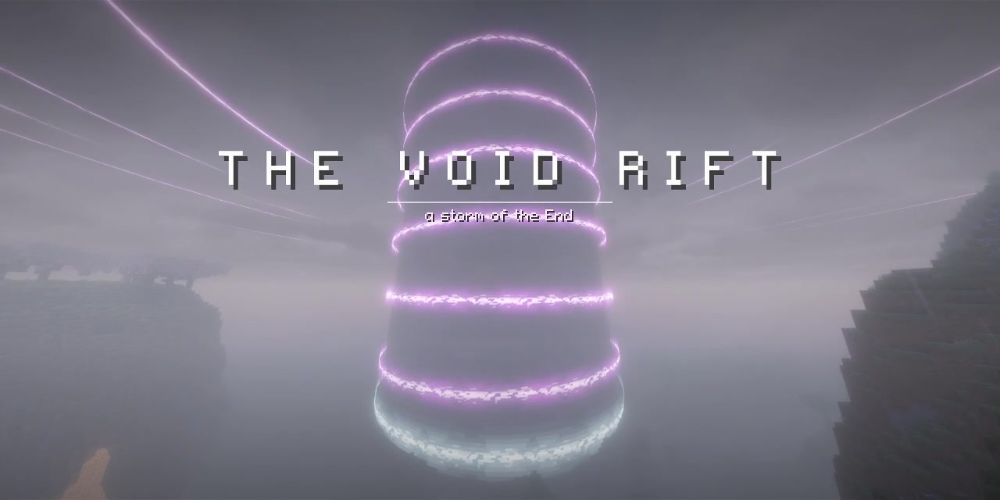
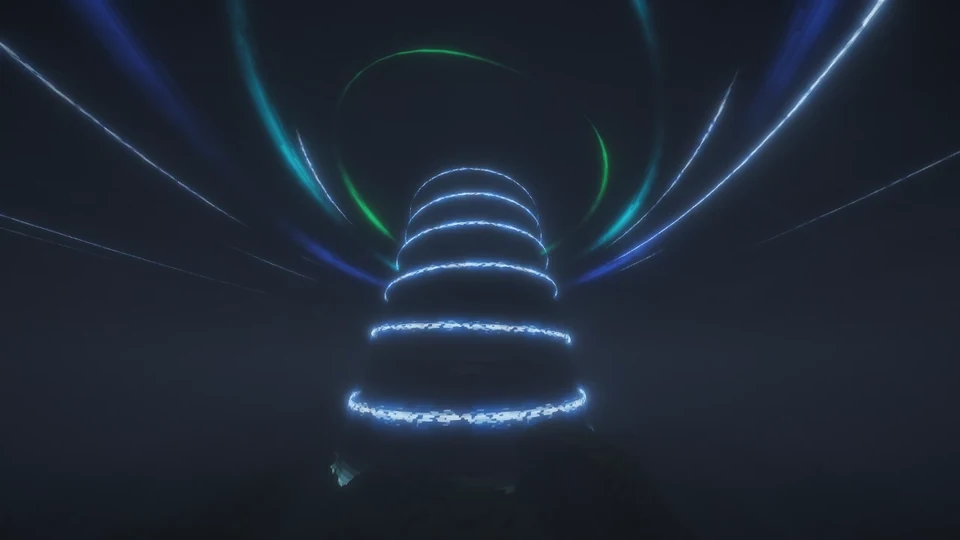

  
  
  
  

# Horizons Unbound

Dimensional storms drift across your world, carrying strange weather, creatures and pieces of somewhere else. Watch the horizon. The colour tells you what is coming.

[Downloads](https://github.com/dcvke/horizons-unbound/releases) · [Field guide](https://github.com/dcvke/horizons-unbound/blob/main/docs/wiki/Home.md)

## The sky splits open

*Click to watch the Void Rift arrive.*

## Four kinds of storm

### Void Rift · End

Distances shift, arrows hang in the air, and an echo of your own character walks somewhere it shouldn't.

### Fire Twister · Nether

Heat waves cross the ground. Hot Crust glows underfoot. In the heart of the column, a passing wave can temper your equipment.

### Thunder Funnel · Overworld

Frost, rain and new streams move with the storm. Watch for glowing ground before the lightning strikes.

### Deep Whisper · Deep Dark

The air falls quiet. The storm listens to your steps, your work, and — with Simple Voice Chat — your voice.

## Watch the full scene

[Play the birth cutscene](https://dcvke.github.io/horizons-unbound-media/video/void-rift-birth.mp4) · [Animated GIF](https://dcvke.github.io/horizons-unbound-media/gif/void-rift-birth.gif) · [Smaller GIF](https://dcvke.github.io/horizons-unbound-media/gif/void-rift-birth-light.gif)

## Before you play

Horizons Unbound supports Minecraft **1.21.1** on NeoForge or Fabric, and **1.20.1** on Forge or Fabric. Install it on the server and every player's client. Fabric also needs Fabric API and Forge Config API Port for your Minecraft version.

Storm frequency, terrain changes, creatures and cutscenes can be adjusted in the mod settings. Hold Shift to skip a cutscene.

[Visit the project](https://github.com/dcvke/horizons-unbound) for installation details, the field guide and downloads.
